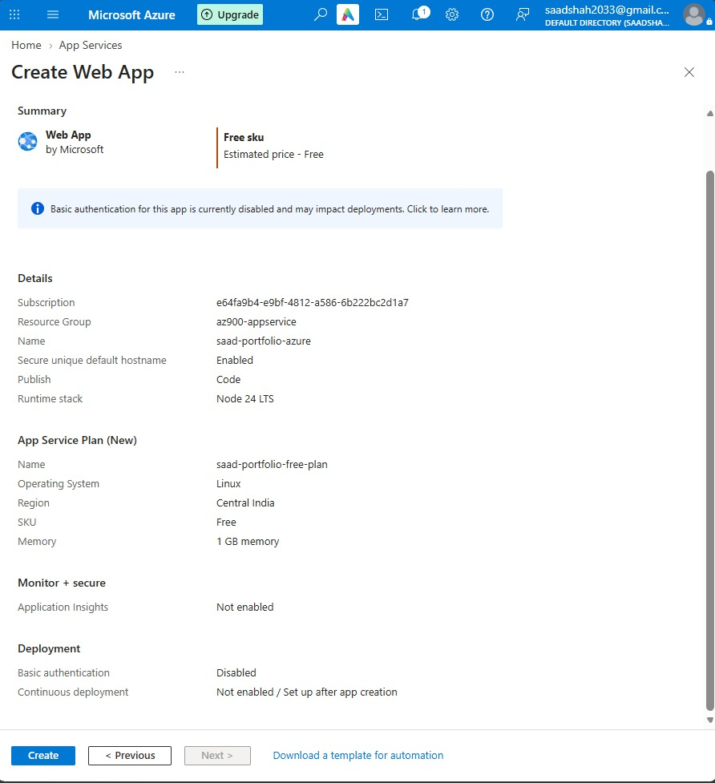
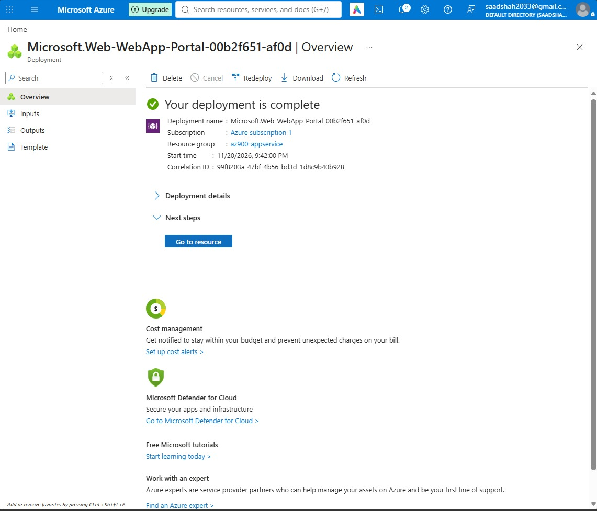
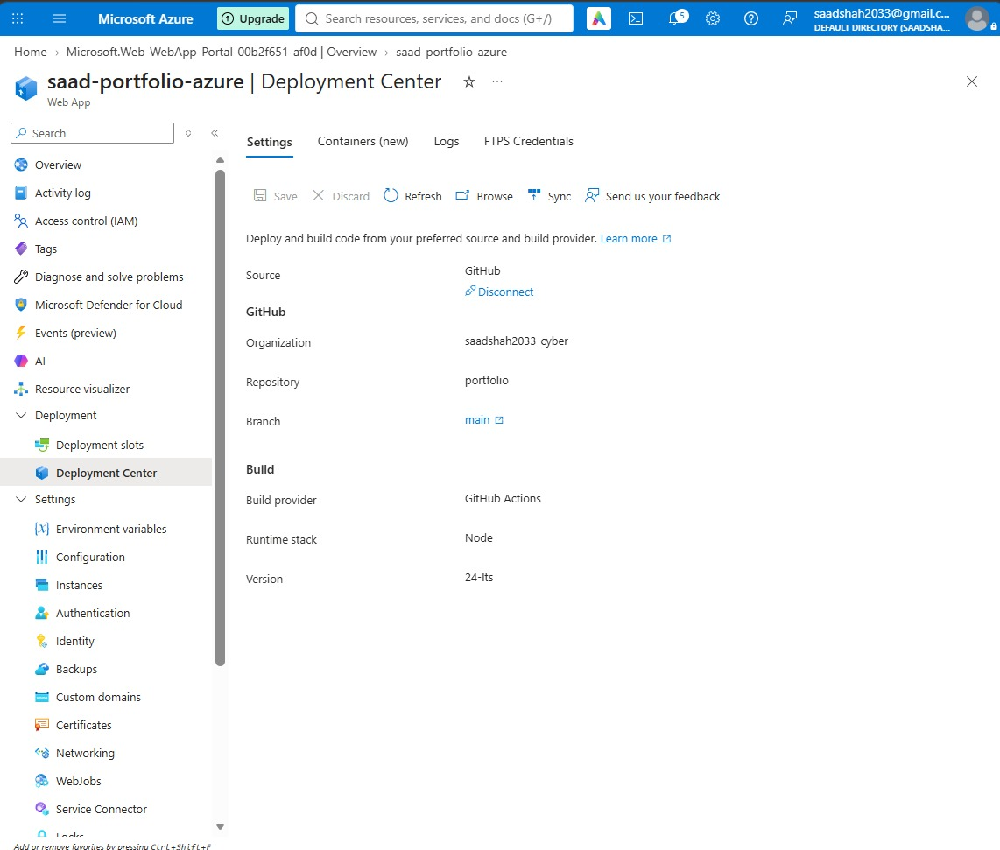
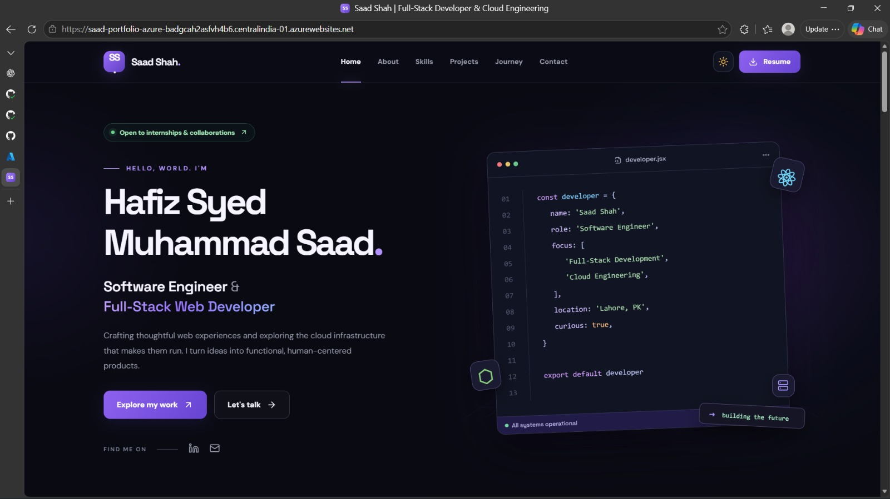
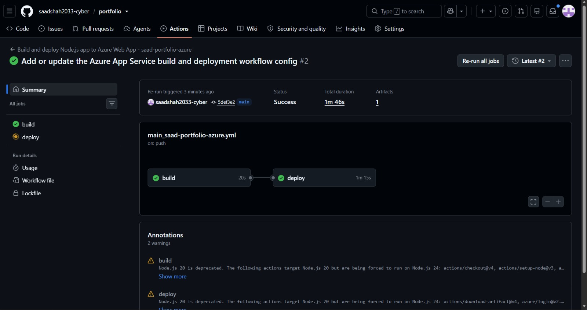
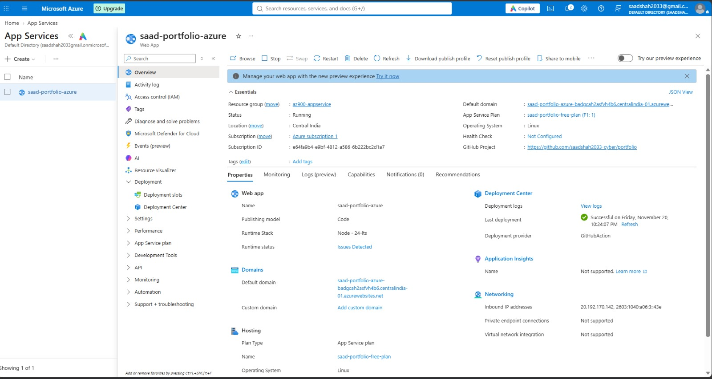
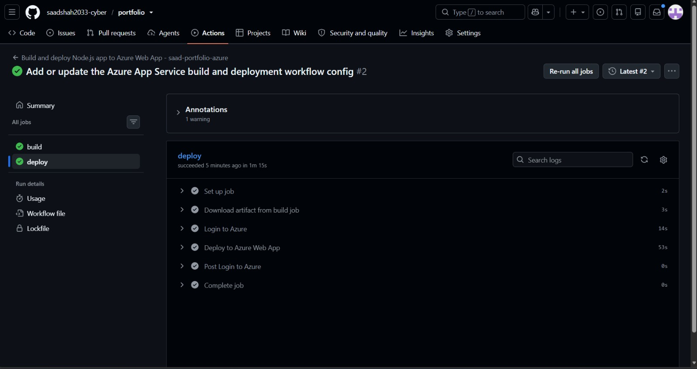

# React Portfolio Deployment on Microsoft Azure App Service using GitHub Actions CI/CD

## Project Overview

This project demonstrates the deployment of my React portfolio website to **Microsoft Azure App Service** using **GitHub Actions for Continuous Integration and Continuous Deployment (CI/CD)**.

The main objective was to gain practical experience with Microsoft Azure, understand cloud application hosting, configure automated deployments, and implement secure authentication using OpenID Connect (OIDC).

## Live Application

- **Original Portfolio:** [View Portfolio on Vercel](https://portfolio-saadshah.vercel.app/)
- **GitHub Repository:** [View Source Code](https://github.com/saadshah2033-cyber/portfolio)

## Technologies Used

- React.js
- Microsoft Azure App Service
- GitHub Actions
- Git and GitHub
- Azure CLI
- OpenID Connect (OIDC) Authentication
- YAML

## Architecture

The deployment follows this workflow:

1. React application is maintained in GitHub.
2. A GitHub Actions workflow is triggered by repository changes.
3. GitHub Actions authenticates with Microsoft Azure using OIDC.
4. The application package is deployed to Azure App Service.
5. Azure App Service hosts the deployed application.

## Project Screenshots

### 1. Azure App Service Creation

Created an Azure App Service to host the React portfolio website. Configured the required resource group, App Service plan, operating system, runtime environment, and deployment region.

### 2. Azure Deployment Overview

Reviewed the Azure deployment configuration and resource details after creating the App Service. This provided an overview of the hosting environment and its deployment setup.

### 3. Deployment Center Configuration

Configured the deployment settings in Azure App Service and explored the available deployment options for integrating the application with GitHub Actions.

### 4. Live Portfolio Website

Verified that the React portfolio was accessible through its Azure App Service URL after deployment.

### 5. GitHub Actions CI/CD Pipeline

Used GitHub Actions to automate the deployment process. The workflow connects the GitHub repository to Azure and handles application deployment whenever the configured workflow is triggered.

### 6. Azure App Service Overview

Inspected the App Service overview to review the deployed resource, hosting configuration, application URL, and service status.

### 7. Successful Deployment Job

Verified the GitHub Actions deployment job and confirmed that the workflow completed successfully.

## Key Learnings

Through this project, I gained practical experience with:

- Deploying a React application to Microsoft Azure App Service.
- Understanding Azure App Service and cloud hosting.
- Configuring GitHub Actions workflows.
- Implementing CI/CD automation.
- Understanding OIDC authentication between GitHub and Azure.
- Managing Azure resources and deployment configurations.
- Troubleshooting deployment and authentication issues.
- Verifying application availability after deployment.

## Conclusion

This project helped me understand how cloud platforms and CI/CD pipelines work together to automate application deployment.

It was a valuable hands-on experience with Microsoft Azure, GitHub Actions, and cloud application hosting.

---

**Project Type:** Cloud Engineering / CI/CD

**Cloud Provider:** Microsoft Azure

**Deployment Platform:** Azure App Service
